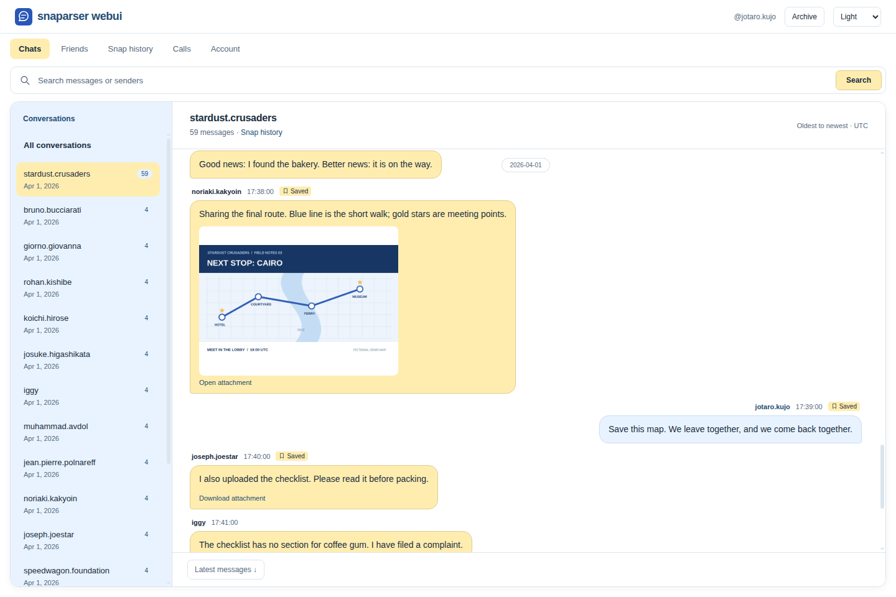

# Snaparser

Snaparser turns Snapchat exports into a searchable local archive.
The parser, SQLite database, and HTMX frontend run in one Go binary.



## Existing solution

Snapchat already provides a static website when downloading
your [data](https://help.snapchat.com/hc/en-us/articles/7012305371156-How-do-I-download-my-data-from-Snapchat-).
It can be used to view your login history, account info, snap
& chat history metadata and a bunch of other useful stuff.
However, there is no search or filtering.

If you want to use it, run the command below:

```
$ python3 -m http.server --directory data/
```
> with data holding the content of your unzipped data

If you want a more powerful ui, continue reading...

## Installation

Install with go:

```sh
$ go install github.com/vanillaiice/snaparser/v2/cmd/snaparser@latest
```

Or download from [releases](https://github.com/vanillaiice/snaparser/releases).

## Usage

Download and unzip your Snapchat export by following the guide on Snapchat's
[website](https://help.snapchat.com/hc/en-us/articles/7012305371156-How-do-I-download-my-data-from-Snapchat-).

Start the browser without supplying paths:

```sh
$ snaparser serve
# http://127.0.0.1:8080
```
If there is no existing archive, the browser opens setup with an in-page folder
browser.
Browse to the unzipped Snapchat export and click **Use this folder**, or enter
its path directly. Processing runs in the background, and the archive opens
automatically when it finishes. The folder browser reads folders on the machine
running Snaparser.

The **Archive** button lets you select another export or **Rebuild archive**
from the saved export. Both actions refresh the database and attachment index
without restarting the server. A failed operation preserves the previous archive.
The selected path is saved in the database and reused on later launches.

To import immediately from the command line:

```sh
$ snaparser serve --data ./data
```

`--data` requires the unchanged export root containing `json/` and `chat_media/`.
Keep this directory in place: the viewer reads attachments from it. `--db` selects the
SQLite path (default `snaparser.db`). To import without serving, then reuse the
archive and its recorded media directory:

```sh
$ snaparser import --data ./data --db archive.db
$ snaparser serve --db archive.db
```

Importing replaces the current backup only after all required JSON files parse
successfully and additional JSON files validate. Missing directories, missing
supported files, or invalid JSON
abort the import without changing an existing archive.

The browser includes:

- **Chats:** full-text search, conversation browsing, older history, links from
  search results to surrounding messages, and image/video/audio attachments.
- **Friends:** searchable relationship lists, including blocked, deleted, pending,
  ignored, hidden suggestions, and sent requests. Click a name to open its chat;
  friends without an imported conversation are marked “No chat history.”
- **Snap history:** the same conversation sidebar, incoming/outgoing bubbles,
  search, surrounding-record links, and older-history navigation as chats.
  Snaps show exported metadata; snap history does not contain attachment IDs.
- **Calls:** incoming/outgoing filters, literal text search, dates, results,
  duration, location, and network information.
- **Account:** account/device details, login/device histories, public and app
  profiles, engagement, content categories, and paged
  account changes.

All sections support ordinary links and forms as well as HTMX navigation, with
System, Light, and Dark themes. See [frontend/README.md](frontend/README.md) for
server integration and view behavior.

## Demo and screenshots

The screenshots use a completely fictional export included in every release
archive under `examples/jojo/`. Download and extract an archive from
[releases](https://github.com/vanillaiice/snaparser/releases), then run this from
the extracted directory to try its conversations, friends, snaps, calls, and
account details:

```sh
./snaparser serve --data ./examples/jojo --db ./jojo-demo.db
# http://127.0.0.1:8080 — select stardust.crusaders
```

On Windows, use `.\snaparser.exe` in place of `./snaparser`. The demo uses a
separate database. Keep `examples/jojo/` in place while browsing its attachments.
The export is not embedded in the binary; users who installed with `go install`
can download a release archive to get the demo files. See
[examples/jojo/README.md](examples/jojo/README.md) for source checkout instructions.

## Configuration

Configuration is optional. Copy [snaparser.example.toml](snaparser.example.toml)
to `snaparser.toml` in your working directory and edit it, or select another file:

```sh
snaparser --config /path/to/archive.toml serve
# --config also works after the subcommand:
snaparser import --config /path/to/archive.toml --data /path/to/export
```

Values take precedence in this order: **explicit CLI flags → TOML → built-in
defaults**. A missing default `snaparser.toml` is fine. An explicitly selected
missing file, invalid TOML, unsupported keys, and invalid setting types produce
an error. Paths in both TOML and flags are relative to the working directory.

```toml
data = ""
db = "snaparser.db"

[server]
listen = "127.0.0.1:8080"
read_header_timeout = "5s"
read_timeout = "15s"
write_timeout = "30s"
idle_timeout = "60s"
shutdown_timeout = "5s"
```

These are the defaults. The server binds to loopback. An empty `data` value
reuses an existing database when serving, or opens browser setup if the selected
database is missing or has no imported archive. A missing database is created
after a valid export is chosen.
`import` requires a nonempty export path.
**Setting `data` in TOML imports that export each time `serve` runs, replacing the
selected archive.** Browser selections update the database's saved source; they
do not rewrite your TOML file. To reuse the database while keeping that setting
in the file:

```sh
snaparser serve --config archive.toml --data=""
```

Duration settings accept Go duration strings such as `500ms`, `30s`, and `2m`.
HTTP timeouts accept `0s` to disable them; the shutdown timeout must be positive.
TOML support uses [urfave/cli's official value-source integration](https://cli.urfave.org/v3/examples/flags/value-sources/).

## Flags

- `--config PATH`, `-c PATH`: TOML file, default `snaparser.toml` (global).
- `--data PATH`: export root containing `json/` and `chat_media/`; needed for
  `import` unless set in TOML, optional for `serve`.
- `--db PATH`: SQLite archive, default `snaparser.db`.
- `--listen ADDRESS`: viewer address, default `127.0.0.1:8080` (`serve` only).
- `--read-header-timeout`, `--read-timeout`, `--write-timeout`,
  `--idle-timeout`, `--shutdown-timeout`: override the matching `[server]`
  duration setting (`serve` only).
- `--version`: print the application version (`2.0.0`).
- `--help`: show command-specific help.

## Architecture

The database represents one complete Snapchat backup at a time. Importing a new
backup replaces all application data. There is no account matching, UPSERT,
deduplication, or incremental synchronization (WIP I guess).

The database API is:

```go
func Open(path string) (*DB, error)
func (db *DB) Close() error
func (db *DB) Import(ctx context.Context, backup parser.Backup) error
```

`parser.Backup` collects the typed results from parsing the supplied JSON files,
along with their filenames and absolute export root for import metadata. It is
not a new JSON format. `LoadBackup` requires every supported JSON file under
`json/`; it validates additional JSON files without importing their contents.
The lower-level `db.Import` API also accepts programmatically supplied partial
backups. Omitted fields clear the corresponding previous data.

The WebUI reads the saved export root and builds one index of its `chat_media`
directory at startup. It resolves attachments as chats are rendered. The same
resolver is available to other callers:

```go
index, err := parser.NewMediaIndex(filepath.Join(exportDirectory, "chat_media"))
if err != nil {
    return err
}
paths := chat.ResolveMediaPaths(index) // chat is a parser.Chat
```

Resolution matches the UTC date in `Created` and each pipe-separated `Media IDs`
value against `YYYY-MM-DD_<ID>.<extension>`. Returned filesystem paths include
the supplied directory and actual file extensions. Missing attachments are
omitted; IDs are never matched across dates. The index is a snapshot of filenames;
rebuild it if the media directory changes. The WebUI displays images, video and
audio controls, and download links for other file types. Missing media displays
an unavailable placeholder. Media bytes stay in the export; paths and files are
not copied into SQLite. Browser imports switch the viewer and media index together.
After an import from a separate CLI process, restart the viewer. If the export
moves, use **Archive** to select its new location and rebuild. Archives imported
before source tracking need reimporting to enable media.

The import implementation follows this sequence:

1. Parse and validate every supplied file before calling `Import`.
2. Begin one database transaction.
3. Delete application data, removing chats and snaps before conversations.
4. Insert the new account, profiles, friends, conversations, messages, histories,
   and other supported parsed data.
5. Record import metadata and the absolute export root for the new backup.
6. Commit once every operation succeeds; roll back on any insertion or commit
   failure. A parsing failure must never start replacement.

The previous backup must remain intact if parsing or insertion fails. Keep the
schema, migration history (`schema_migrations`), indexes, and triggers between
imports. Delete source rows only; FTS5 triggers maintain the search indexes
within the same transaction.

Account and profile tables are singletons, enforced by a primary key constrained
to `1`. Other tables do not need account ownership foreign keys. Chats and snaps
retain their foreign keys to conversations. The initial schema and FTS migration
describe this layout for new databases; an existing database that has already
applied them would require a separate schema migration.

## Development

```sh
make check
make build
# Equivalent commands: go test ./..., go vet ./..., go mod verify
# The native binary is written to bin/snaparser (snaparser.exe on Windows).
```

Tests use synthetic exports and temporary databases; a private `data/` directory
is not required. Database tests cover replacement of a complete backup, clearing
omitted sections, rollback of source rows and full-text indexes, profile/friend
round trips, timestamp normalization, and paged history queries.

The supported files are `account.json`, `account_history.json`,
`chat_history.json`, `friends.json`, `snap_history.json`, `snap_pro.json`,
`talk_history.json`, and `user_profile.json`. Additional JSON files are validated
but their contents are not imported. Empty placeholder types marked TODO in
`parser/types.go` still need nonempty export examples before their schemas and
storage can be implemented; their contents are not stored or displayed.

## Release preparation

`make release` runs the checks and creates archives for Linux, macOS, and Windows
on amd64 and arm64 under `dist/v2.0.0/`, including documentation, the example TOML,
licenses, screenshots, the fictional demo export, and `SHA256SUMS`. Packaging lives
entirely in the Makefile and requires Go 1.26 or newer, Make, `tar`, `zip`, and
either `sha256sum` or `shasum`. Normal builds need only Go.

See [RELEASING.md](RELEASING.md) for the release procedure and
[CHANGELOG.md](CHANGELOG.md) for the 2.0.0 release notes. The tag workflow creates
a **draft** GitHub release for review; building locally does not publish anything.

## Author(s)

vanillaiice & codex (from v2)

## License

BSD-3-Clause
